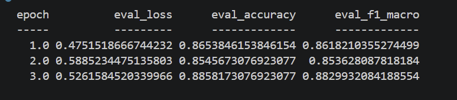
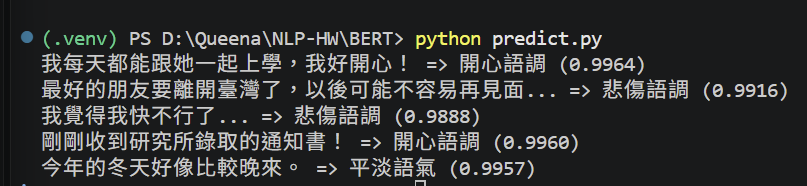

# 中文句子情緒分類

使用中文 BERT 微調模型，將中文句子分類為八種情緒，並輸出預測類別與 confidence。

## 訓練資料來源

資料集：[Chinese_Multi-Emotion_Dialogue_Dataset](https://huggingface.co/datasets/Johnson8187/Chinese_Multi-Emotion_Dialogue_Dataset)

- 有效資料：4,159 筆
- 訓練集：3,327 筆（80%）
- 驗證集：832 筆（20%）
- 分割方式：分層抽樣，random_state=42

情緒類別以實際 CSV 為準：

| 標籤編號 | 情緒類別 |
| --- | --- |
| 0 | 厭惡語調 |
| 1 | 平淡語氣 |
| 2 | 悲傷語調 |
| 3 | 憤怒語調 |
| 4 | 疑問語調 |
| 5 | 開心語調 |
| 6 | 關切語調 |
| 7 | 驚奇語調 |

## 基礎模型

- 模型：[google-bert/bert-base-chinese](https://huggingface.co/google-bert/bert-base-chinese)
- 分類架構：BertForSequenceClassification
- 輸出類別：8 類

## 安裝套件

Python 版本：3.12.10

| 套件 | 使用版本 |
| --- | --- |
| torch | 2.14.1+cu132 |
| transformers | 4.57.1 |
| datasets | 5.0.1 |
| accelerate | 1.15.0 |
| numpy | 2.5.4 |
| pandas | 3.1.0 |
| scikit-learn | 1.9.1 |

## 說明

本專案使用 `google-bert/bert-base-chinese` 預訓練模型，讓模型學習句子內容與情緒標籤之間的關係，並將輸入句子歸入八種情緒類別之一。

訓練前，將文字情緒標籤轉換為 0～7 的整數。

| 訓練參數 | 設定 |
| --- | --- |
| Epochs | 3 |
| 訓練 batch size | 8 |
| 驗證 batch size | 16 |
| Learning rate | 2e-5 |
| Weight decay | 0.01 |
| 最大輸入長度 | 128 tokens |
| Seed | 42 |

每個 Epoch 進行一次驗證，依驗證集 Macro F1 選出最佳模型，儲存至 output/。

預測時使用 softmax 計算各類別的機率，取最高者作為預測情緒，並將 confidence 顯示至小數點後四位。

### 預測結果

```text
我每天都能跟她一起上學，我好開心！ => 開心語調 (0.9964)
最好的朋友要離開臺灣了，以後可能不容易再見面... => 悲傷語調 (0.9916)
我覺得我快不行了... => 悲傷語調 (0.9888)
剛剛收到研究所錄取的通知書！ => 開心語調 (0.9960)
今年的冬天好像比較晚來。 => 平淡語氣 (0.9957)
```

## 執行方法

在專案根目錄執行：

1. 確認資料位於 `data/data.csv`。
2. 執行 `python train.py`，訓練並儲存最佳模型至 `output/`。
3. 執行 `python predict.py`，載入模型並輸出五句中文的預測結果。

若已有完整的 `output/` 模型，可直接執行 `python predict.py`。

## 成果

### 訓練評估結果

| Epoch | 驗證 Loss | Accuracy | Macro F1 |
| --- | ---: | ---: | ---: |
| 1 | 0.475152 | 86.54% | 86.18% |
| 2 | 0.588523 | 85.46% | 85.36% |
| 3 | 0.526158 | **88.58%** | **88.30%** |

Epoch 3 的驗證集 Macro F1 最高，因此選為最佳模型。以上為驗證集成績，表格數值經四捨五入。



### 預測執行截圖


